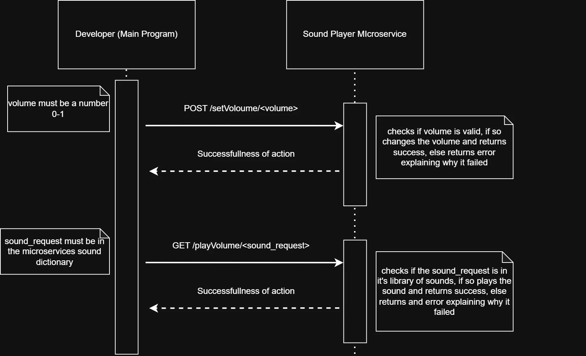

# READ ME 
## Endpoints explained

### [GET] /playSound/<sound_request>
- Purpose: Play's a given sound based on name
- Parameters: sound_request, string representing what sound to play
- Side Effect: Plays said sound
- Return: If the sound playing was successful, or an error explaining why it wasn't

### [POST] /setVolume/<volume>
- Purpose: Set the volume for all future sounds to volume passed
- Parameters: volume, number between 0-1 representing the new volume (0 = mute, 1 = 100% volume)
- Side Effect: Changes the volume variable
- Return: If the volume changing was successful, or an error explaining why it wasn't

## Example Code

```python
import requests

URL = "http://127.0.0.1:5000/" 
PLAYSOUND = URL + "playSound/"
SET_VOLUME = URL + "setVolume/"

# How to change the volume
response = requests.post(SET_VOLUME+".5")
print(response.json()) # {'message': 'Volume set to 0.5 successfully!'}

# How to play a sound
response = requests.get(PLAYSOUND+"Game_over") # hears sound playing
print(response.json()) # {'message': 'Sound Game_over at volume 0.5 played successfully!'}

```

## UML Diagram


